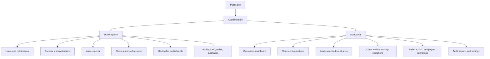
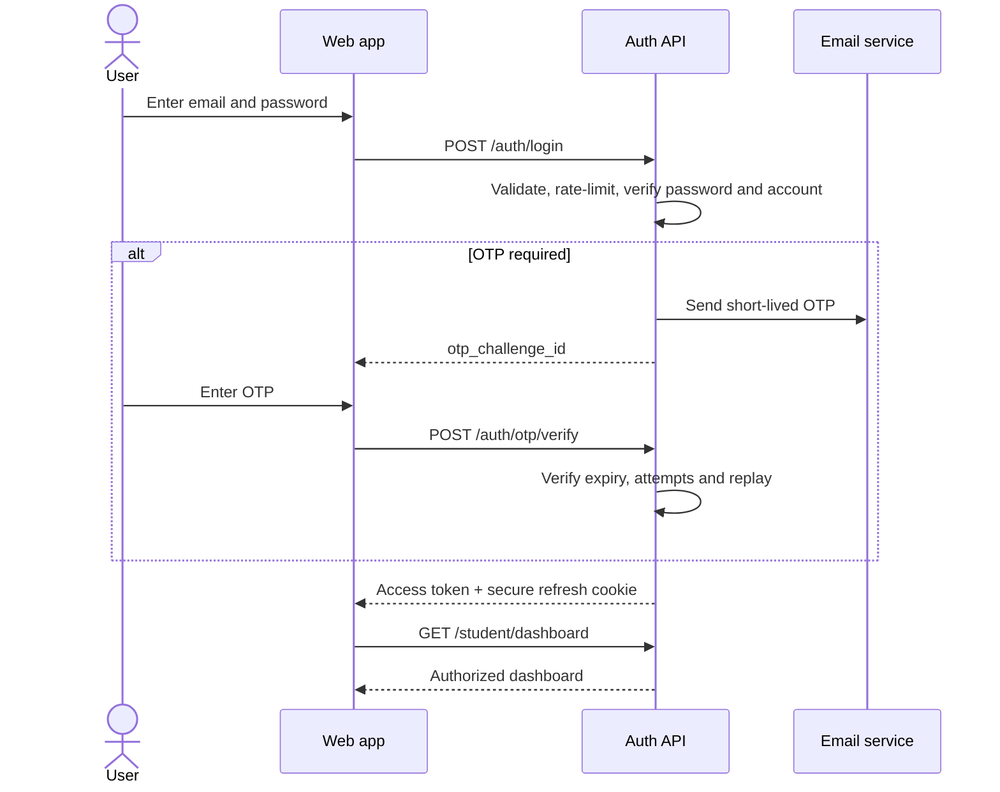
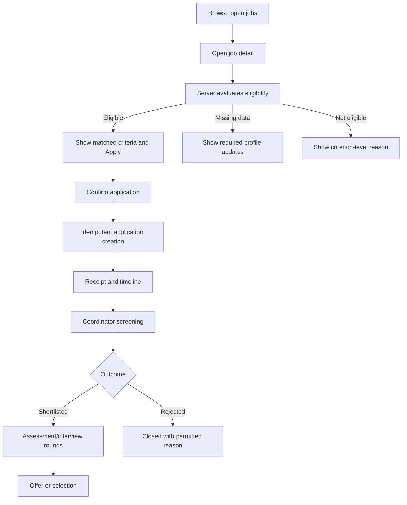
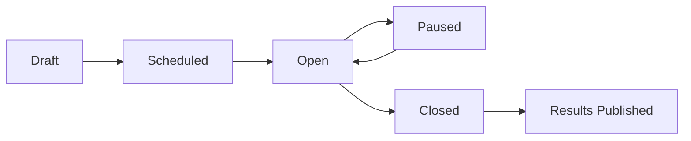
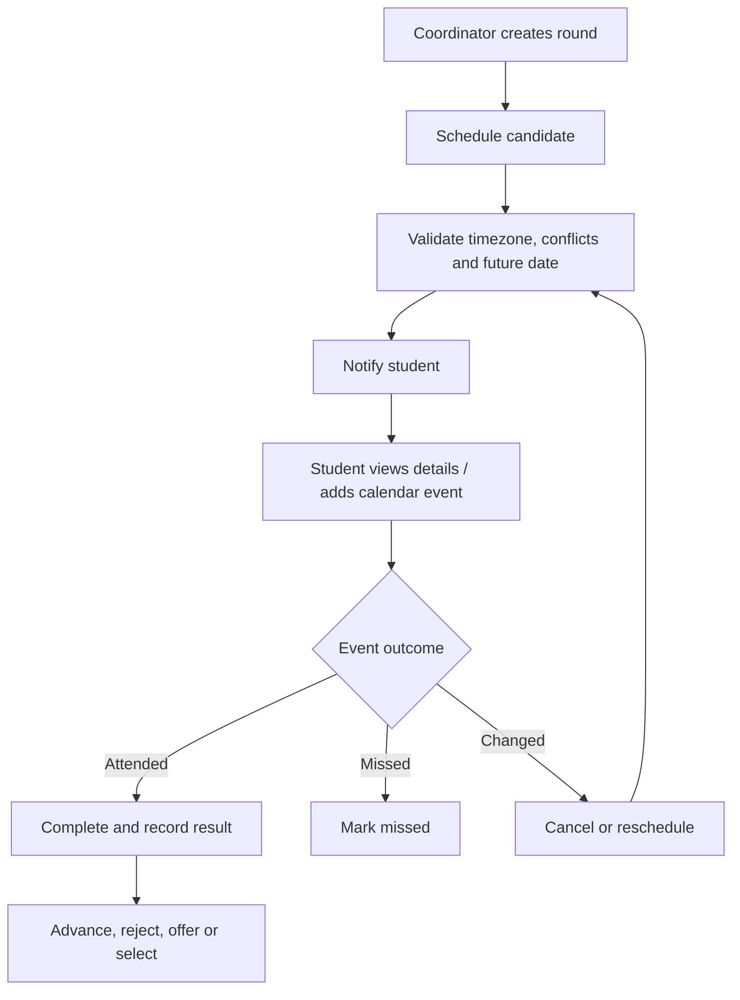
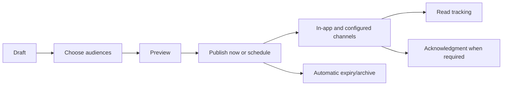
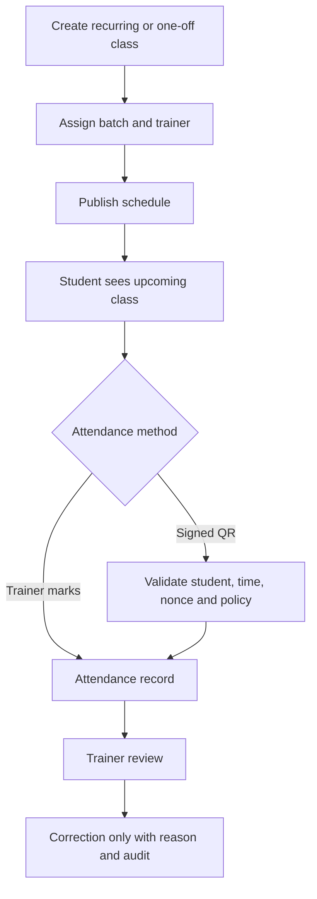
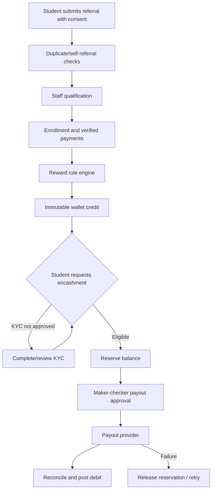
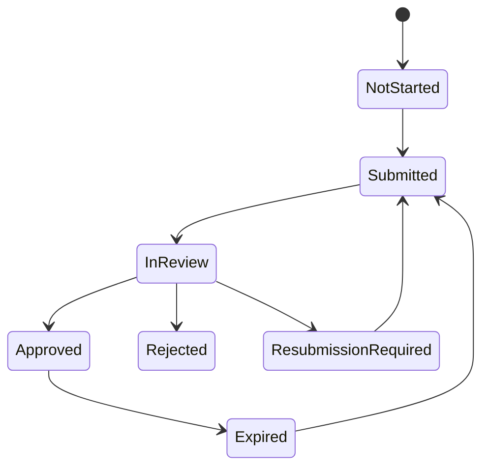
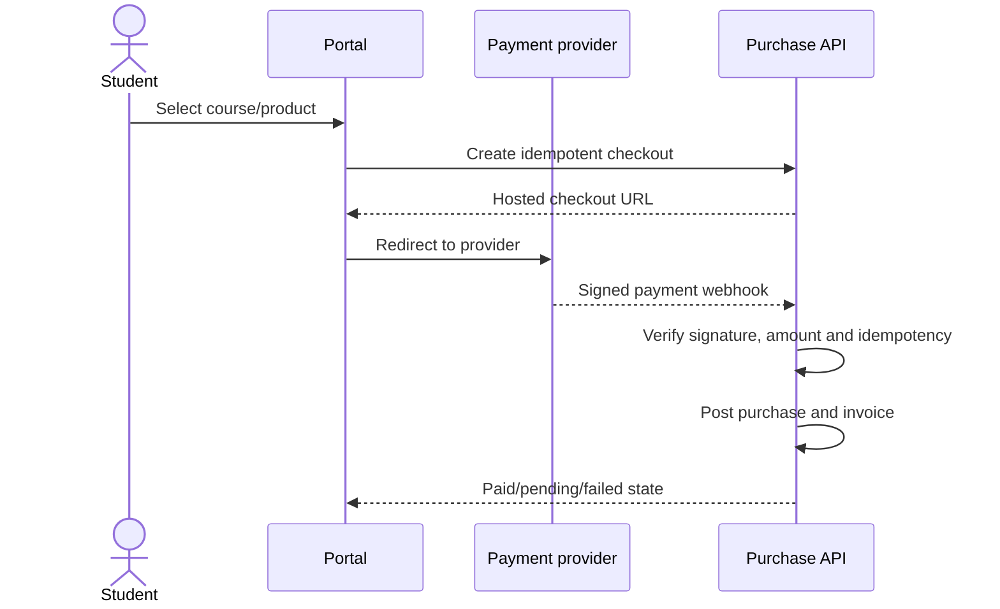

# CareerOS — End-to-End Product Flows

This document complements `CAREER_PORTAL_PRD_V2.md`. Mermaid diagrams are logical flows; every permission and transition must also be enforced by the API.

## 1. Platform map



## 2. Authentication



## 3. Job discovery and application



## 4. Assessment lifecycle



```mermaid
sequenceDiagram
  actor S as Student
  participant W as Exam UI
  participant API as Assessment API
  participant J as Timeout worker
  S->>W: Open assigned assessment
  W->>API: Request eligibility and instructions
  API-->>W: Server-authoritative availability
  S->>W: Confirm readiness
  W->>API: Idempotent start
  API-->>W: Paper snapshot, server time, deadline
  loop During attempt
    S->>W: Answer or mark for review
    W->>API: Autosave answer
    W->>API: Heartbeat and integrity events
  end
  alt Student submits
    W->>API: Idempotent submit
  else Deadline expires
    J->>API: Finalize expired attempt
  end
  API->>API: Score using immutable paper
  API-->>W: Receipt; result only if visible
```

## 5. Interview scheduling



## 6. Announcement flow



## 7. Class and attendance flow



## 8. Referral, reward and encashment



## 9. KYC



## 10. Purchase flow



## 11. Navigation rules

- Main student navigation is stable across authenticated pages.
- Active route is visually and programmatically identified.
- Secondary destinations live in a labelled More drawer.
- Account, security, KYC, wallet, purchase history and logout live in the profile menu.
- Destination controls use links; mutation controls use buttons.
- Browser back/forward and deep-link refresh must preserve a valid route and correct document title.

